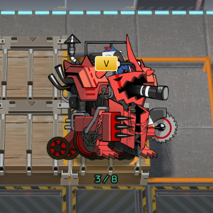
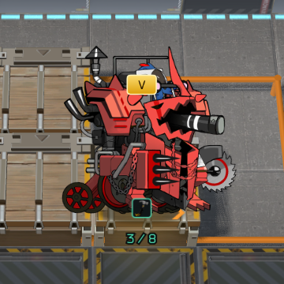
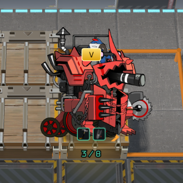
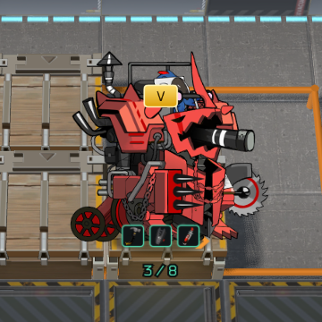
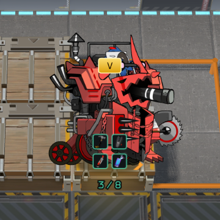
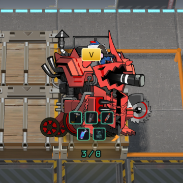
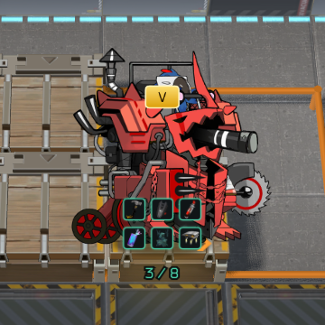
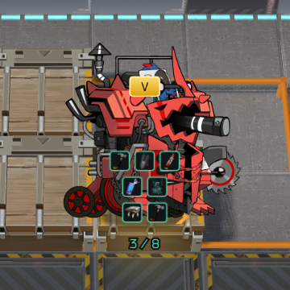
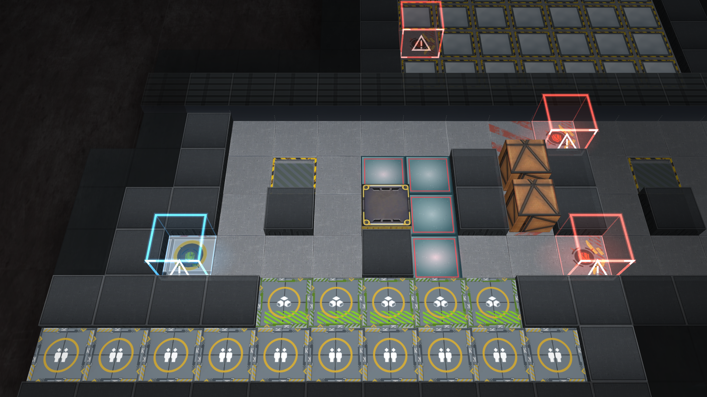
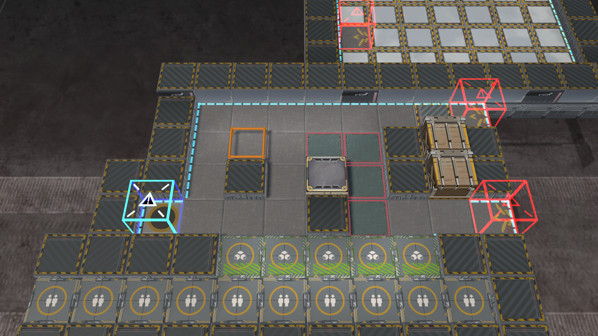

# Equipment HUD and MAP09 screenshots

Firefox 157, 1920×1080, DPR 1. Captured from independent patches based on mainline dev f8a6619b.
Equipment: ac59ef04; MAP09: 50ffac95. These are real renderer screenshots, not mockups.

Equipment images are direct 360×360 browser crops at original resolution; the full six-item capture is included.
The fixture's 3 / 8 label checks progress spacing; seven icons exercise rendering of additional zero-slot equipment,
not a claim that Ironhide has seven slots. MAP09 uses the procedural board: native map models and particles are
outside that PR. The local render-demo harness disables CSP because upstream's demo fetches a data URL.
No page exceptions or failed HTTP responses in the final capture. This is targeted visual verification, not a full match test.

| Count | Layout | Screenshot |
| --- | --- | --- |
| 0 | empty |  |
| 1 | 1 |  |
| 2 | 2 |  |
| 3 | 3 |  |
| 4 | 2+2 |  |
| 5 | 3+2 |  |
| 6 | 3+3 |  |
| 7 | 3+2+2 |  |

[Full six-item frame](equipment-6-full.png)

## MAP09

