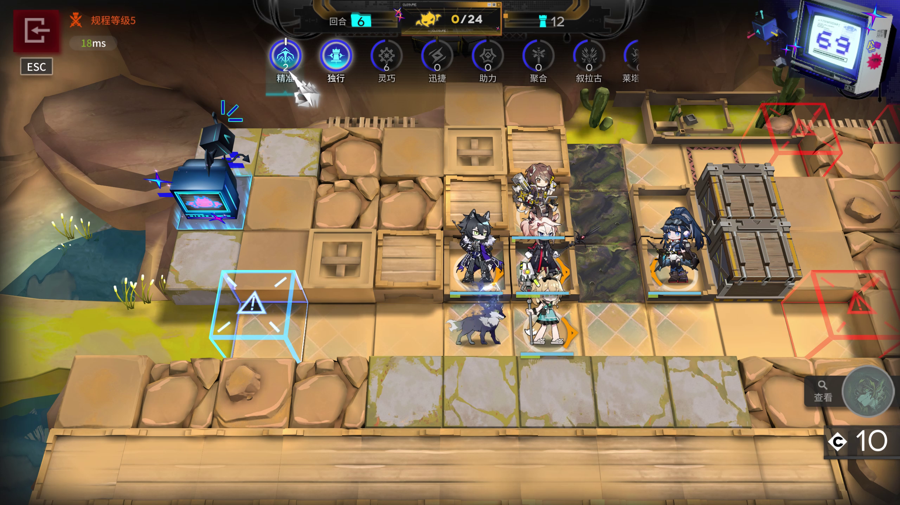

# 官服无层数盟约证据剪辑

## highest-active.mp4

原片：明日方舟 2026-11-25 01-52-06.mp4。
剪辑 00:00–00:30 对应原片 02:10–02:40；剪辑约 00:30 后接原片 04:36–05:21.6。
保留独行单独激活的阵容，以及精准新激活后在休整结束获得 2 层、打开详情确认的过程。原片 05:18 的下图显示精准 2 层、计敌 0/24 同屏，可排除场上伺夜的击倒叠层。

## adjacent-active.mp4

原片：明日方舟 2026-11-25 01-41-48.mp4。
剪辑 00:00–00:18 对应原片 00:45–01:03；剪辑约 00:18 后接原片 03:22–04:00.3。
保留邻位叠层阵容、调整阵容、零人盟约收起和灵巧详情的过程。

两份剪辑均为原画面顺接；去音轨，1920×1080、30 fps、H.264，前置索引。
原片保留不变，片段区间与格式见 manifest.json。

## 本地修复对照

基线为主线 dev c7cea5a9b。同一受控 Match：注入独行旧余额 33，激活精准，触发整备区星源，随后将独行人数归零。
基线结果为独行 35／精准 0；修复后为独行 0／精准 2，激活总层数为 2。零人独行随之收起。
`baseline-*` 是主线基线，`work-*` 是 PR 分支，`fork-*` 是本服适配；均以各自真实 Match 的私有盟约视图驱动真实 UI 组件。
Chrome、Firefox 各完成 1440×900、844×390 的触发／归零截图和详情开关。页面、控制台、HTTP 错误为零。
场景和浏览器结果见同目录 JSON。
