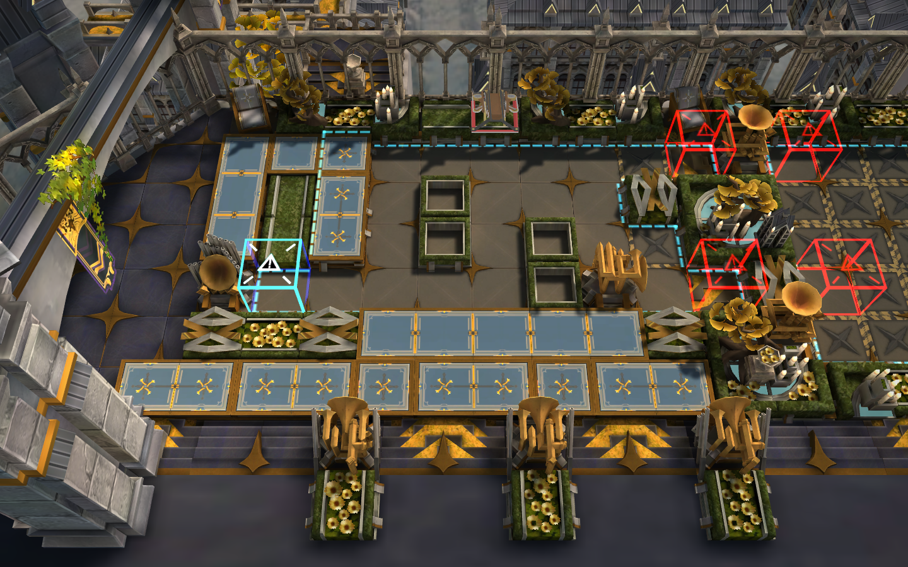
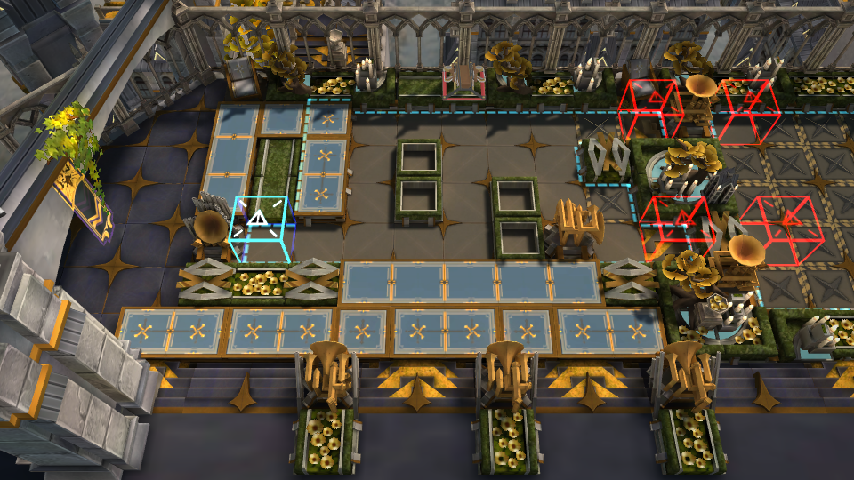
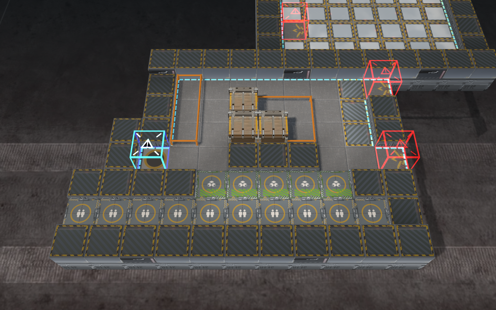

# 盐坨子炮准备棋盘与表现复验（2026-11-21）

PR #986：`b2f81d423ea06a8f04d3acf2bab057da94b75225`，基于 `dev d675b81d93a98e137e133e75f5662f02bc06e080`；#985 已由维护者合入并补齐复核修正及规程黄金数据。

- `enterBattle`、`drawStage`、重建 3D 都区分 `m.field.prep`，准备棋盘保留静态炮台与箱子。
- 缺模型时保留原灰色炮台顶面；准备阶段无出生特效，待机／落点标记复用明确标为 [ASSUMED]。
- 炮台原版销毁与通用死亡兜底均不叠加碎箱粒子。文档给出 11 个命名 FX 的合并提取命令。

定向／文档 228 项通过，8 项可选提取素材／Pillow 环境检查跳过；类型、导入与改动 lint 通过，保留原警告。
新增的仓库浏览器回归测试实际执行 1 项并通过，覆盖 MAP10 炮台与旧图箱子、地形重建和 2D／3D 往返。
该 Chrome 测试使用本机 Linux 启动适配（SwiftShader、独立临时浏览器）；资源由只读 overlay 提供，未修改源素材。

随后 Chrome／Firefox 各 11 张图、7 组收据核验准备阶段普通／Boss 棋盘、短屏、缺模型、箱子及实际战斗销毁。
真实 HTTP 服务器与渲染器；准备棋盘为受控 `m.field.prep` 夹具，战斗来自本分支真实 Battle 首帧和死亡事件，未运行完整 WS 对局。
Chrome 无页面／控制台／HTTP 错误；Firefox 仅既有 data-URL CSP 诊断，控制台／HTTP 错误为零。
完整本机模拟／golden 继续暂停；新主线 CI 单独运行，不据此声明本轮完整模拟通过。

初轮销毁截图夹具用 `h.step()` 消耗了 harness 已收集的事件，导致死亡事件未送给渲染器；改用实际 Battle 的 step／drainEvents 后，两端都得到原版销毁 1 次／通用死亡 0 次，或关闭特效时原版 0 次／通用 1 次，两者碎箱均为 0。原失败收据保留在本机。

