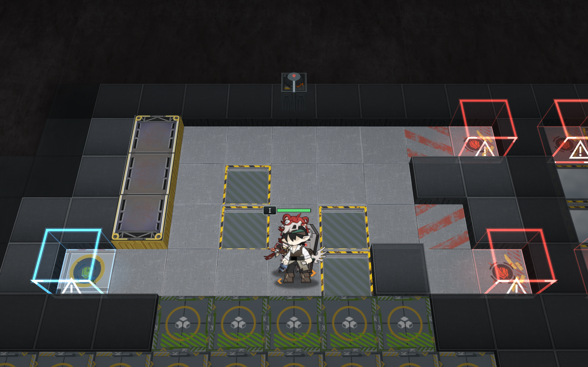

# 盐坨子炮评审复验（2026-11-21）

当前基线 `dev 6870c725b27c0f6edefee621b0358037ae177822`；玩法 PR #985 `f5d44aa1ee79eb165be99f1c9c595d5ceccd1063`；表现 PR #986 `95ad5d7fbf5767bfafa83e3b4f7f1e4ffe2a3044`。

- 普通炮弹清除后保留 Eat 乘客，下一发仍可释放；最终弹清除才击杀乘客。
- x-4 按 3×3 格判定，空炮自身销毁没有干员击杀归因；生成器共用官方天赋射程查询。
- 逐单位命中特效播放，2D／3D 战斗都隐藏静态炮台；素材缺失、迟到恢复、暂停与销毁清理复验。

新基线玩法定向 241 项通过；表现定向 207 项通过、7 项可选素材／Pillow 环境检查跳过。两边类型、改动 lint、导入检查通过，原警告保留。初轮新增翻译检查及规程离线数据重建通过，输出未变；重基底后生成器与炮台模块内容保持一致。完整本机模拟与 golden 仍暂停，主线 Actions 已启动；规程 golden 由维护者合并时重算。

Chrome／Firefox 初轮各覆盖普通、联防、Boss 和桌面／短屏，包括真实指针点击、页面 API 的特效档位及 2D／3D 切换、迟到素材、销毁和命中事件。重基底后分别重跑普通战场两尺寸的上述关键流程，JSON 名称为 chrome-newbase-results 和 firefox-newbase-results。两个基线实际重新生成的 Battle 帧逐字节相同，摘要保存其 SHA-256。真实渲染器与本分支 Battle 帧；使用受控编队，未运行完整 WS 对局。Firefox 保留原 data-URL CSP 诊断，其余页面／控制台／HTTP 错误为零。

Chrome 初轮一个瞬间截图为空，已排除；等待两次动画帧后重拍正常。Firefox 初轮在命中后 0.034 秒断言尚未消费事件，改在同一批真实帧的 19.1 秒等待命中消费后通过。原失败收据保留在本机，生产时钟与 CSP 保持原样。

以下普通战场两图来自上述最新基线。

初轮 Boss 短屏截图：

