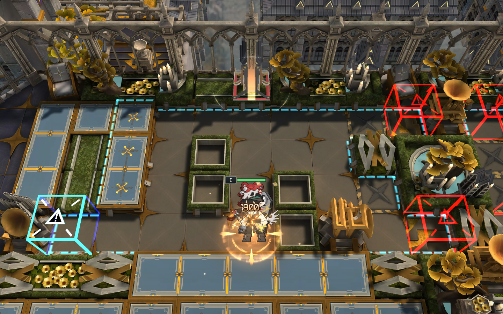
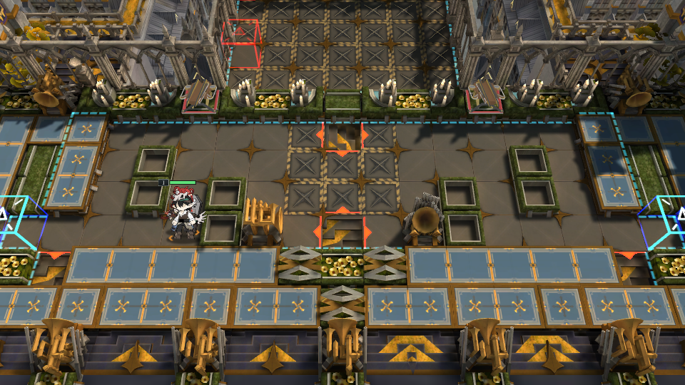

# 盐坨子炮评审复验（2026-11-21）

玩法 PR #985：`f431a29e9dbfc5cc99ab5e83daeb431032a2f56d`；依赖表现 PR #986：`c9a9eefa63817b9f387c584b4094ec93d33a6d1a`。

- 普通炮弹清除后保留 Eat 乘客，下一发仍可释放；最终弹清除才击杀乘客。
- x-4 改为 3×3 格，空炮自身销毁没有干员击杀归因；生成器共用官方天赋射程查询。
- 逐单位命中特效播放，2D／3D 战斗都隐藏静态炮台；素材缺失、迟到恢复、暂停与销毁清理复验。

本机玩法定向 241 项通过；表现定向 207 项通过、7 项可选素材／Pillow 环境检查跳过。格式整理后的相关检查分别 79 项通过、79 项通过及 7 项跳过；类型、改动 lint、导入与新增翻译检查通过，原警告保留。规程数据已离线重建，输出未变。完整本机模拟与 golden 仍暂停；主线 CI 和合并时的规程 golden 不计作本轮已通过。

Chrome／Firefox 均检查普通、联防、Boss 和桌面／短屏，包含真实指针点击、页面 API 的特效档位及 2D／3D 切换、迟到素材、销毁和命中事件。真实渲染器与本分支 Battle 帧；使用受控编队，未运行完整 WS 对局。Firefox 保留原 data-URL CSP 诊断，其余页面／控制台／HTTP 错误为零。

Chrome 初轮一个瞬间截图为空，已排除；等待两次动画帧后重拍正常，原失败图与记录保留在本机。Firefox 初轮在命中后 0.034 秒断言尚未消费事件，改在同一批真实帧的 19.1 秒等待命中消费后通过，原失败收据保留。没有修改生产时钟或放宽 CSP。摘要和场景收据见本目录 JSON。

